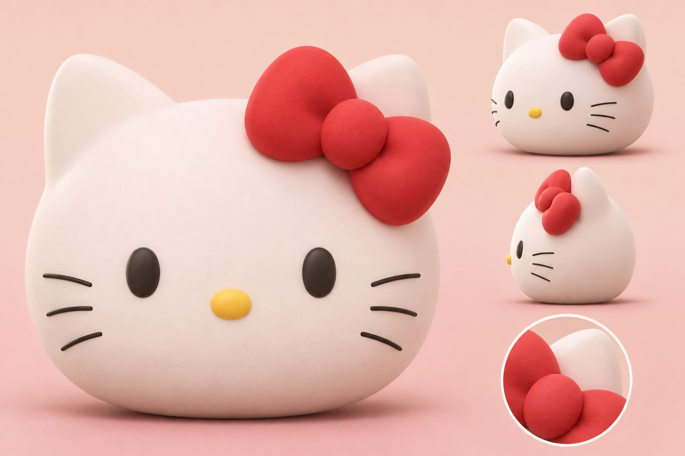
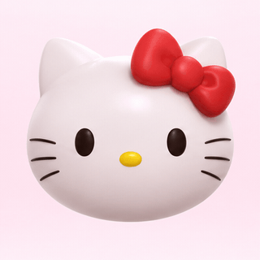
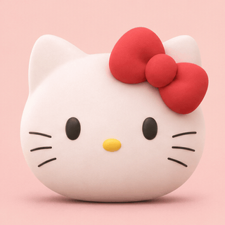

# Prévia visual da gatinha em 3D

Proposta para avaliação em 10/11/2026. Imagens de conceito; não são modelo 3D,
animação executável nem captura do display físico. Nenhum código do produto foi
alterado nesta etapa.

## Identidade preservada

Cabeça branca arredondada, orelhas curtas, dois olhos escuros ovais, nariz pequeno
amarelo, três bigodes de cada lado e laço vermelho grande na orelha do lado
direito de quem olha. Sem corpo, roupa ou boca falante. Volume suave e materiais
foscos para manter a silhueta legível em 240 × 320 pixels.

## Arquivos

- `personagem-v1.png`: vista frontal, três quartos e lateral.
- `animacoes-v1.png`: seis poses propostas, lidas da esquerda para a direita,
  de cima para baixo.
- `tela-v1.png`: composição ilustrativa no formato retrato do display.
- `piscar-e-inclinar-v2.gif`: ciclo visual de oito quadros, em loop, com piscar,
  inclinação leve e movimento do laço.
- `conclusao-v2.gif`: ciclo visual de oito quadros, em loop, com pequena reação
  alegre após a resposta.
- `quadros-v2.png` e `quadros-conclusao-v2.png`: folhas de quadros que deram
  origem aos GIFs.

### Veja as prévias

[Composição ilustrativa no display](tela-v1.png) ·
[Seis poses de estado](animacoes-v1.png)

## Movimentos sugeridos para discutir

| Estado | Movimento visual sugerido |
| --- | --- |
| Espera | Respiração quase imperceptível; piscar espaçado. |
| Missão escolhida | Inclinação curta da cabeça e balanço discreto do laço. |
| Ouvindo | Olhar atento; bigodes reagem levemente ao nível de voz. |
| Processando | Olhos olham para cima; cabeça vira poucos graus. |
| Dica | Inclinação gentil em direção à pessoa. |
| Conclusão | Olhos sorriem e laço faz um movimento curto. |

Esses são **quadros de intenção**, não uma estimativa de FPS ou viabilidade na
placa. Antes de implementar, decidir se o ESP32 exibirá quadros 3D pré-renderizados
ou fará renderização em tempo real; medir memória, armazenamento, taxa de quadros
e legibilidade no LCD físico. O desenho gerado também não comprova que o elemento
de marca pode ser usado comercialmente; revisar identidade/licença se o projeto
deixar de ser protótipo acadêmico.

Prompts usados: personagem 3D mantendo os traços do SVG atual; storyboard de seis
reações com a mesma personagem; tela conceitual sem recursos de hardware inventados.
Geração feita com a ferramenta integrada de imagens.

Os GIFs foram montados para revisão a 4 quadros por segundo a partir das folhas
de poses. Eles demonstram ritmo e direção; há pequenas variações de forma entre
quadros gerados, e o movimento precisa ser redesenhado com um modelo 3D único
antes de virar um asset final do produto.
